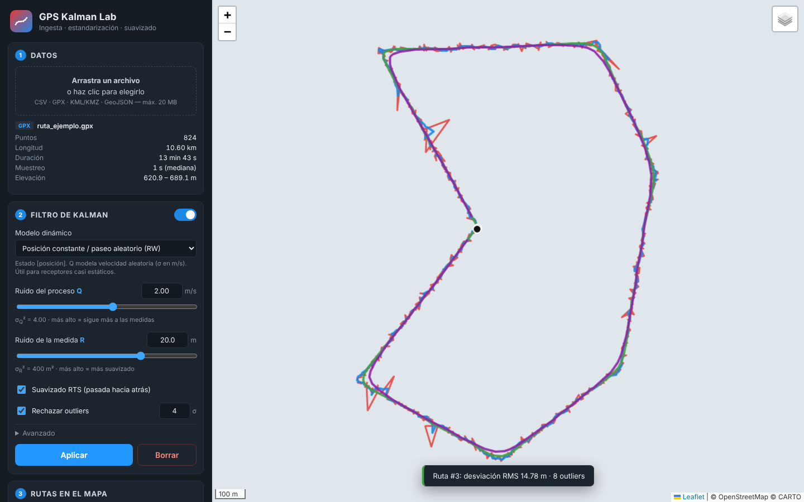

# GPS Kalman Lab

Aplicación web en Python (Flask) para cargar trayectorias GPS en varios formatos, estandarizarlas, suavizarlas con un **filtro de Kalman** configurable y comparar visualmente varias rutas filtradas sobre un mapa interactivo. Está preparada para desplegarse en **Render** de forma nativa (sin Docker).



## Funcionalidades

| Área | Detalle |
|---|---|
| **Ingesta** | CSV/TXT/TSV, GPX, KML, KMZ y GeoJSON. Detecta el formato por extensión y, si no la hay, por el contenido. |
| **Estandarización** | Todo se convierte a `[[lat, lon, ele\|null, t\|null], ...]` (WGS84, metros, segundos epoch UTC). Ordena por tiempo, descarta coordenadas no válidas y avisa de las anomalías. |
| **CSV flexible** | Detecta el separador (`,` `;` tab `\|`), la coma decimal y cabeceras en inglés o español (`lat/latitude/latitud`, `lon/lng/longitud`, `ele/alt/altitud`, `time/timestamp/fecha+hora`…). Tiempos ISO 8601, epoch en s o ms y fechas libres. |
| **Mapa** | Leaflet + OpenStreetMap por defecto (sin API key), con capas Claro / OSM / Satélite. Si defines `GOOGLE_MAPS_API_KEY`, usa **Google Maps** y aparece un selector para alternar. Si Google falla, vuelve a OSM automáticamente. |
| **Filtro de Kalman** | Modelos de velocidad constante (CV) o paseo aleatorio (RW); parámetros Q y R; suavizado RTS hacia atrás; rechazo de outliers por distancia de Mahalanobis; filtrado opcional de la elevación; `dt` real a partir de las marcas de tiempo. |
| **Flujo** | **Aplicar** añade una nueva ruta filtrada con otro color (pueden acumularse para compararlas). **Borrar** elimina todas las filtradas y deja solo la original (roja). El interruptor del panel activa o desactiva el filtro. Cada ruta se puede ocultar, quitar o exportar a GeoJSON (clic) o CSV (Mayús+clic). |

## Estructura

```
gps-kalman-app/
├── app/
│   ├── __init__.py          # create_app(): configuración por variables de entorno y errores JSON
│   ├── routes.py            # GET /  · GET /healthz · POST /api/upload · POST /api/filter
│   ├── kalman.py            # Filtro CV/RW + suavizador RTS + gating, en plano local ENU
│   ├── parsers/             # csv · gpx · kml/kmz · geojson → Track estándar
│   ├── templates/index.html
│   └── static/              # css, js (maps.js = adaptadores Leaflet/Google, app.js = UI), vendor/leaflet
├── sample_data/             # La misma ruta con ruido y outliers en los 4 formatos
├── scripts/make_samples.py  # Regenera los ejemplos
├── tests/                   # pytest: parsers, filtro y API
├── wsgi.py                  # Entrada WSGI (y servidor de desarrollo)
├── gunicorn.conf.py         # bind 0.0.0.0:$PORT, workers, timeouts
├── render.yaml              # Blueprint de Render
├── requirements.txt         # Dependencias de producción con versiones exactas (incluye transitivas)
├── requirements-dev.txt     # + pytest
└── .python-version          # 3.13
```

## Ejecutar en local

```bash
python -m venv .venv && source .venv/bin/activate      # Windows: .venv\Scripts\activate
pip install -r requirements-dev.txt
python -m pytest                                        # 35 tests
python wsgi.py                                          # http://localhost:5000
# o igual que en producción:
PORT=5000 gunicorn -c gunicorn.conf.py wsgi:app         # gunicorn no funciona en Windows: usa python wsgi.py
```

Carga `sample_data/ruta_ejemplo.gpx` (o cualquiera de los otros formatos) para probar.

## Despliegue en Render

### Opción A: Blueprint (recomendada)
1. Sube esta carpeta a un repositorio de GitHub, GitLab o Bitbucket.
2. En Render: **New + → Blueprint** y elige el repositorio. Render lee `render.yaml`.
3. Si quieres Google Maps, introduce `GOOGLE_MAPS_API_KEY` cuando te la pida (o déjala vacía para usar OSM).
4. Cuando acabe el deploy, la app estará en `https://gps-kalman-lab.onrender.com` (o el nombre que asigne Render).

### Opción B: Web Service manual
- **Runtime:** Python 3
- **Build Command:** `pip install -r requirements.txt`
- **Start Command:** `gunicorn -c gunicorn.conf.py wsgi:app`
- **Health Check Path:** `/healthz`

### Cosas que ya resuelve el proyecto
- Escucha en `0.0.0.0` y en el puerto de la variable `PORT` que inyecta Render (`gunicorn.conf.py`).
- La versión de Python se fija con `.python-version` (`3.13` → la última 3.13.x). Si prefieres usar la variable `PYTHON_VERSION`, Render exige la versión completa (p. ej. `3.13.5`).
- Leaflet va incluido en `static/vendor`: no depende de ningún CDN.
- El backend no guarda estado (la ruta cruda viaja con cada petición), así que funciona con varios workers y sobrevive a los reinicios del plan gratuito.
- En el plan gratuito, el servicio se duerme tras unos minutos sin tráfico; la primera petición posterior tarda en despertar.

### Variables de entorno

| Variable | Por defecto | Uso |
|---|---|---|
| `PORT` | 10000 (la pone Render) | Puerto de escucha |
| `WEB_CONCURRENCY` | 2 | Workers de gunicorn |
| `MAX_UPLOAD_MB` | 20 | Tamaño máximo de archivo |
| `MAX_POINTS` | 200000 | Puntos máximos por trayectoria |
| `GOOGLE_MAPS_API_KEY` | — | Activa Google Maps (Maps JavaScript API) |
| `GOOGLE_MAPS_MAP_ID` | `DEMO_MAP_ID` | Map ID para los marcadores avanzados; crea uno propio en Google Cloud para producción |

**Google Maps:** habilita *Maps JavaScript API* en Google Cloud y restringe la clave por *HTTP referrer* a `https://<tu-servicio>.onrender.com/*`. La clave se envía al navegador (es lo normal en la API JS), por eso conviene restringirla.

## El filtro, en breve

Las coordenadas se proyectan a un plano tangente local en metros. Como Q y R son diagonales, los ejes este, norte y vertical son independientes y se filtran por separado con un modelo 1D.

- **CV (velocidad constante):** estado `[p, v]`, `F = [[1, dt], [0, 1]]`,
  `Q = σ_Q² · [[dt⁴/4, dt³/2], [dt³/2, dt²]]` (σ_Q = aceleración aleatoria, m/s²).
- **RW (paseo aleatorio):** estado `[p]`, `Q = σ_Q² · dt` (σ_Q = velocidad aleatoria, m/s).
- **Medida:** `H = [1, 0]`, `R = σ_R²` (σ_R = error típico del GPS en metros; 3–10 m es habitual).
- **RTS:** pasada hacia atrás que usa también las medidas futuras. Da una ruta más suave y precisa, pero no sirve en tiempo real.
- **Gating:** descarta una medida si su distancia de Mahalanobis a la predicción supera *k*σ. Tras 5 rechazos seguidos se fuerza la actualización para no "perder" la pista después de un salto real.

**Cómo ajustarlo:** subir R o bajar Q da una ruta más suave pero con más retraso en las curvas; bajar R o subir Q hace que la ruta siga más de cerca las medidas. En la ruta de ejemplo (ruido σ = 6 m y un 1 % de saltos), CV con Q = 0,5, R = 6, RTS y gating a 4σ reduce el error frente a la trayectoria real de unos 11 m a unos 2,6 m.

## API

```
POST /api/upload   multipart/form-data, campo "file"
  → { name, format, points: [[lat, lon, ele, t], ...], summary: {...}, warnings: [...] }

POST /api/filter   application/json
  { "points": [[lat, lon, ele, t], ...],
    "params": { "model": "cv", "q": 0.5, "r": 5, "smoother": true, "gate": 4,
                "filter_ele": true, "q_ele": 0.2, "r_ele": 10, "dt_default": 1, "vel0": 10 } }
  → { points, stats: { rms_dev_m, max_dev_m, rejected, length_raw_m, length_filtered_m, ... }, params }
```
